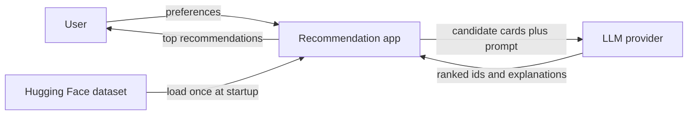
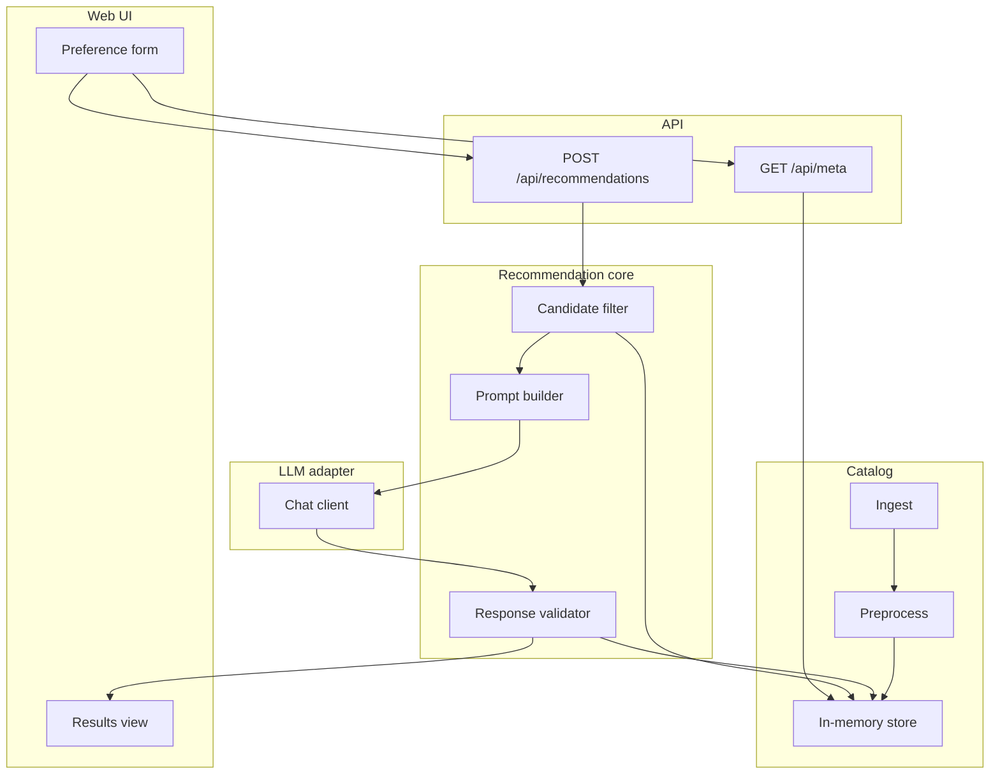
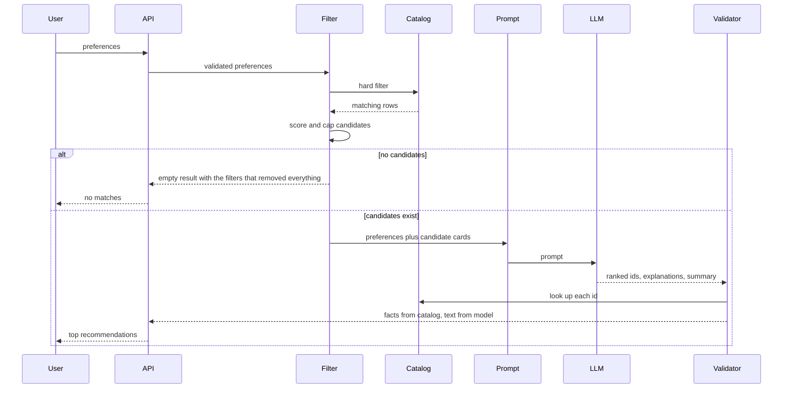

# Architecture

## Purpose

This document is the architecture for the AI-powered restaurant recommendation system described in [problemStatement.md](problemStatement.md).

The system suggests restaurants from the Hugging Face Zomato dataset. Structured preferences narrow the catalog first. A large language model then ranks that short list and writes an explanation for each pick. Restaurant facts shown to the user always come from the catalog, never from text the model invents.

## Architectural goals

- **Grounded recommendations.** Every result is a row that survived filtering. Name, cuisine, rating, and cost are copied from the catalog after the model responds.
- **Small model context.** The raw set is about 51,700 listings, and `reviews_list` can be enormous. The model sees a capped set of compact candidate cards.
- **One request path.** A preference form, one recommendation API, and one orchestration service. Booking, accounts, and a live Zomato API are out of scope.
- **Replaceable model.** Prompting is the integration. The provider sits behind one adapter so the rest of the system does not depend on a specific API.

## System context



| Actor | Responsibility |
| --- | --- |
| User | Enters location, budget, cuisine, minimum rating, and optional free text. Reads the ranked list. |
| Recommendation app | Owns the catalog, filtering, prompt, validation, and the page that shows results. |
| Hugging Face dataset | Source of restaurant facts. Loaded at startup, not on each request. |
| LLM provider | Ranks the supplied candidates and writes explanations. It does not search the web or the full dataset. |

## Style and stack

A single Python service with a small web UI. The dataset fits in memory after preprocessing, so there is no database.

| Layer | Choice | Why |
| --- | --- | --- |
| UI | Server-rendered pages plus a small client script | One form and one results view. No separate frontend app. |
| API | FastAPI | One JSON endpoint for recommendations and one for form metadata. |
| Catalog | pandas in memory, snapshot on disk | About 51,700 rows. Filtering is in-process. |
| Dataset access | `datasets` library | Loads `ManikaSaini/zomato-restaurant-recommendation` from Hugging Face. |
| LLM | Provider adapter with JSON output | Ranking and explanations stay behind one interface. |

```text
app/
  main.py                 # app startup, routes
  api/
    recommendations.py    # request and response models, HTTP handlers
  catalog/
    ingest.py             # download and snapshot
    preprocess.py         # clean, dedupe, budget bands
    store.py              # in-memory catalog
  recommend/
    filter.py             # hard filters and candidate cap
    prompt.py             # prompt and candidate cards
    engine.py             # orchestrates filter, LLM, validation
    validate.py           # drop unknown ids, attach catalog facts
  llm/
    client.py             # provider adapter
  web/
    templates/            # preference form and results
    static/
data/
  catalog.parquet         # processed snapshot, generated at startup
```

## Components



| Component | Does | Does not |
| --- | --- | --- |
| Web UI | Collects preferences and renders the top matches. | Filter, rank, or call the model directly. |
| API | Validates input and returns metadata or recommendations. | Hold business rules beyond request checks. |
| Ingest | Downloads the Hugging Face split and writes a raw snapshot. | Clean fields. |
| Preprocess | Parses rating and cost, splits cuisines, assigns a budget band, dedupes listings. | Call the model. |
| Store | Serves the processed table and the distinct locations and cuisines for the form. | Persist user queries. |
| Candidate filter | Applies hard filters, then caps the list sent to the model. | Write explanations. |
| Prompt builder | Turns preferences and candidate cards into one prompt that demands JSON. | Add restaurants that are not in the candidate list. |
| LLM adapter | Sends the prompt and parses JSON. | Choose restaurants from outside the prompt. |
| Validator | Keeps only returned ids that were in the candidate set, and fills display fields from the catalog. | Trust model-written ratings or prices. |

## Runtime

### Startup

1. If `data/catalog.parquet` exists and matches the configured dataset revision, load it.
2. Otherwise download the `train` split, preprocess it, and write the parquet snapshot.
3. Hold the frame in memory.
4. Build the location and cuisine lists used by `GET /api/meta`.
5. Refuse to serve recommendations until the catalog is ready.

### Recommendation request



Target behavior for a normal request: filtering is local and fast; the model call dominates latency. The API waits for one completion, with one retry if the JSON is invalid.

## Data architecture

### Source

| | |
| --- | --- |
| Dataset | `ManikaSaini/zomato-restaurant-recommendation` |
| Split | `train` (about 51,700 rows) |
| Coverage | Bangalore restaurant listings |

Source columns and how the pipeline uses them:

| Source column | Use |
| --- | --- |
| `name` | Display name. Part of the dedupe key. |
| `address` | Dedupe key. Not shown unless needed later. |
| `location` | Locality. Primary match for the user's location. |
| `listed_in(city)` | Broader Bangalore area. Secondary location match. |
| `cuisines` | Comma-separated list. Split, trimmed, lowercased for filtering. Original casing kept for display. |
| `rate` | Strings such as `4.1/5`. Parsed to a float. `NEW`, `-`, and blanks become missing and fail a minimum-rating filter. |
| `votes` | Tie-break and pre-rank signal. More votes make a rating more trustworthy. |
| `approx_cost(for two people)` | Parsed to an integer cost in INR. Commas removed. Missing cost fails a budget filter. |
| `rest_type` | Included on the candidate card. Helps the model judge soft preferences such as quick service. |
| `dish_liked` | Short liked-dish list on the candidate card when present. |
| `online_order`, `book_table` | Yes/No flags on the candidate card. |
| `listed_in(type)` | Merged across duplicate rows (for example Buffet, Delivery). |
| `reviews_list` | Not sent in full. Optional short excerpt only, and only when additional preferences are present. |
| `url`, `phone`, `menu_item` | Dropped. They are not needed for filtering or for the explanation. |

### Canonical record

Preprocess writes one row per restaurant:

| Field | Type | Notes |
| --- | --- | --- |
| `id` | string | Stable hash of normalized name plus address. |
| `name` | string | |
| `location` | string | Locality. |
| `area` | string | `listed_in(city)`. |
| `cuisines` | list of strings | Normalized for matching. |
| `cuisines_display` | string | Human-readable cuisine list. |
| `rating` | float or null | Parsed from `rate`. |
| `votes` | int | |
| `cost_for_two` | int or null | INR. |
| `budget_band` | `low`, `medium`, or `high` | From the thresholds below. Null when cost is missing. |
| `rest_type` | string | |
| `dish_liked` | string | Truncated. |
| `online_order` | bool | |
| `book_table` | bool | |
| `listed_types` | list of strings | Union across duplicate listings. |
| `review_excerpt` | string | At most a few hundred characters, or empty. |

### Preprocessing rules

1. Strip whitespace. Treat empty strings as missing.
2. Parse `rate` by taking the numeric portion before `/`. Reject values outside 0–5.
3. Parse cost by removing commas and converting to an integer.
4. Split `cuisines` on commas.
5. Deduplicate on normalized `name` + `address`. The same restaurant appears more than once because Zomato lists it under multiple types and areas. Keep the row with the highest `votes`, and union `cuisines` and `listed_in(type)`.
6. Assign `budget_band` from cost for two:

| Band | Cost for two (INR) |
| --- | --- |
| `low` | 500 or less |
| `medium` | 501–1,500 |
| `high` | more than 1,500 |

These cutoffs are configuration, not dataset fields. They match a Bangalore cost-for-two scale and can be changed without touching the request path.

7. Drop rows that have no name. Keep rows with missing rating or cost in the catalog, but hard filters exclude them when the user sets a minimum rating or a budget.

### What is stored on disk

`data/catalog.parquet` is a cache of the canonical table plus the dataset revision it was built from. Deleting the file forces a fresh download and preprocess. The raw `reviews_list` is not stored in the snapshot.

## Filtering and ranking

Hard filters run in this order:

1. **Location.** Case-insensitive match on `location` or `area`. The form sends a value chosen from `/api/meta`, so free-typed typos are not the normal path.
2. **Cuisine.** At least one cuisine token contains the requested cuisine.
3. **Budget.** `budget_band` equals the requested band.
4. **Minimum rating.** `rating` is present and greater than or equal to the requested minimum.

Rows that fail a hard filter never reach the model.

If more than 15 rows remain, pre-rank them and send the top 15. The pre-rank score is:

```text
rating * log(1 + votes)
```

This only decides who is eligible for the model. The model produces the order the user sees.

If zero rows remain, the API returns an empty list and names which filter removed the last rows. It does not call the model, and it does not relax filters silently. A later change can add an explicit "broaden search" action.

Additional preferences (family-friendly, quick service, and similar text) are not hard filters. They are included in the prompt so the model can use `rest_type`, `dish_liked`, `listed_types`, and the short review excerpt.

## LLM integration

### Candidate card

Each card is only the fields the model needs:

```json
{
  "id": "8f3a…",
  "name": "Jalsa",
  "location": "Banashankari",
  "cuisines": "North Indian, Mughlai, Chinese",
  "rating": 4.1,
  "votes": 775,
  "cost_for_two": 800,
  "rest_type": "Casual Dining",
  "online_order": true,
  "book_table": true,
  "dish_liked": "Pasta, Lunch Buffet, Dum Biryani",
  "listed_types": ["Buffet"]
}
```

`review_excerpt` is attached only when the user supplied additional preferences.

### Prompt contract

The prompt tells the model to:

- Rank only the supplied ids.
- Return at most 5 restaurants.
- Explain each pick using the user's preferences and the card fields.
- Write a one- or two-sentence summary of the set.
- Return JSON and nothing else.
- Leave out a restaurant rather than invent one.

Expected model JSON:

```json
{
  "summary": "Short overview of the set.",
  "recommendations": [
    {
      "id": "8f3a…",
      "rank": 1,
      "explanation": "Why this restaurant fits."
    }
  ]
}
```

### Validation

After the model responds:

1. Parse JSON. On failure, retry once with a shorter repair prompt that includes the invalid output. On a second failure, use the fallback below.
2. Discard any id that was not in the candidate set.
3. Discard duplicate ids. Keep the first.
4. Sort by `rank`. If ranks are missing or repeated, keep the model’s list order.
5. Truncate to 5.
6. Join each surviving id to the catalog and overwrite name, cuisines, rating, and cost with catalog values.
7. If the model drops every id, use the fallback.

### Fallback

When the model is unavailable or its output cannot be used, return the top 5 candidates in pre-rank order. The explanation states that the list is ordered by rating and number of votes, and that a written recommendation was unavailable. The summary says the same. The page still shows name, cuisine, rating, and cost.

## API

### `GET /api/meta`

Response:

```json
{
  "locations": ["Banashankari", "Koramangala 5th Block"],
  "cuisines": ["Chinese", "Italian", "North Indian"],
  "budget_bands": ["low", "medium", "high"],
  "rating_min": 0,
  "rating_max": 5
}
```

Locations and cuisines are the distinct values in the catalog, sorted. This is what the form offers so filter values match the data.

### `POST /api/recommendations`

Request:

```json
{
  "location": "Banashankari",
  "budget": "medium",
  "cuisine": "Chinese",
  "min_rating": 4.0,
  "additional_preferences": "quick service"
}
```

| Field | Rule |
| --- | --- |
| `location` | Required. Must be one of the meta locations. |
| `budget` | Required. `low`, `medium`, or `high`. |
| `cuisine` | Required. Must be one of the meta cuisines. |
| `min_rating` | Required. Number from 0 to 5. |
| `additional_preferences` | Optional. Plain text, length-capped. |

Response:

```json
{
  "summary": "Two casual spots in Banashankari with Chinese on the menu and a rating of 4 or higher.",
  "recommendations": [
    {
      "id": "8f3a…",
      "name": "Jalsa",
      "cuisines": "North Indian, Mughlai, Chinese",
      "rating": 4.1,
      "cost_for_two": 800,
      "budget_band": "medium",
      "location": "Banashankari",
      "explanation": "Rated 4.1 with Chinese on the menu and a medium cost for two."
    }
  ],
  "meta": {
    "candidate_count": 12,
    "used_fallback": false
  }
}
```

`candidate_count` is how many rows passed the hard filters before the cap. `used_fallback` is true when explanations were not produced by the model.

Empty match:

```json
{
  "summary": "No restaurants matched these filters.",
  "recommendations": [],
  "meta": {
    "candidate_count": 0,
    "used_fallback": false,
    "empty_reason": "No rows matched location, cuisine, budget, and minimum rating."
  }
}
```

Errors:

| Status | When |
| --- | --- |
| 400 | Missing field, unknown location or cuisine, rating out of range. |
| 503 | Catalog is not loaded yet. |
| 200 with `used_fallback: true` | Model failed after one retry. The user still gets catalog-backed rows. |

## Web UI

Two states of one page.

**Form**

- Location and cuisine are selects filled from `/api/meta`.
- Budget is three options: low, medium, high. The page states the INR ranges.
- Minimum rating is a number input or slider from 0 to 5, step 0.1.
- Additional preferences is an optional text area.
- Submit calls `POST /api/recommendations` and stays on the page.

**Results**

- Summary at the top.
- Up to five cards. Each card shows name, location, cuisine, rating, cost for two, budget band, and the explanation.
- When `used_fallback` is true, a short note says the list was ordered by rating and votes.
- When the list is empty, the page shows `empty_reason` and leaves the form filled so the user can change a filter.

The UI does not recompute rank or rewrite facts.

## Configuration

| Setting | Purpose |
| --- | --- |
| `DATASET_ID` | Default `ManikaSaini/zomato-restaurant-recommendation`. |
| `DATASET_REVISION` | Pin the snapshot so a rebuilt catalog is reproducible. |
| `CATALOG_PATH` | Default `data/catalog.parquet`. |
| `BUDGET_LOW_MAX` | Default `500`. |
| `BUDGET_MEDIUM_MAX` | Default `1500`. |
| `CANDIDATE_LIMIT` | Default `15` cards in the prompt. |
| `RESULT_LIMIT` | Default `5` cards on the page. |
| `LLM_MODEL` | Model name for the adapter. |
| `LLM_API_KEY` | From the environment. Never written into the repo or the prompt logs. |
| `LLM_TIMEOUT_SECONDS` | Bound on the completion call. |

## Failure behavior

| Failure | Response |
| --- | --- |
| Dataset download fails at startup | Process exits. No empty catalog is served. |
| Catalog still loading | `503`. |
| Zero hard-filter matches | `200` with an empty list and `empty_reason`. No model call. |
| Model timeout or HTTP error | One retry, then catalog fallback. |
| Model returns invalid JSON | One repair retry, then catalog fallback. |
| Model cites an unknown id | That item is dropped. Remaining valid items are returned. |
| Model changes a rating or a price in prose | Display fields still come from the catalog. The explanation is shown as written. |

## Deployment

One process is enough:

- Load the catalog before accepting traffic.
- Read the API key from the environment.
- Keep the parquet snapshot on a local volume so restarts do not re-download.
- Log request filters, candidate count, model latency, fallback use, and validation drops. Do not log the API key or full review text.

No queue, cache of user queries, or separate model service is required for this scope.

## Decisions

| Decision | Reason |
| --- | --- |
| Filter in the app, then prompt | The problem requires data-grounded suggestions, and the raw reviews cannot go into a prompt. |
| In-memory catalog, no database | The processed table is small and read-only at request time. |
| Dedupe by name and address | Source rows repeat a restaurant across listing types. |
| Cap of 15 candidates and 5 results | Keeps the prompt small and the page readable. |
| Model returns ids only | Stops hallucinated restaurants from reaching the page. Display facts are joined back from the catalog. |
| Fallback to the pre-rank | A model outage still returns real restaurants. |
| No silent filter relaxation | An empty result stays honest about what the user asked for. |

## Out of scope

- User accounts, saved preferences, booking, ordering, and payments.
- A live Zomato API. Hugging Face is the source.
- Training or fine-tuning. The model is prompted.
- Semantic search over the full review corpus. Soft preferences are judged from the short candidate card.
- Multi-city support. This dataset is Bangalore listings; location means a locality or listed area inside that data.
