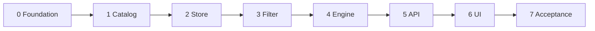

# Implementation plan

Phase-by-phase plan for the restaurant recommendation app in [architecture.md](architecture.md). Each phase ends with a check that does not depend on later phases. Do not start a phase until the previous phase's exit check passes.

The build is one Python service: a FastAPI app, an in-memory catalog, a filter-then-prompt recommendation path, and one server-rendered page.

## Phase 0 — Foundation

**Goal.** A runnable app skeleton, pinned dependencies, and configuration that later phases read instead of hard-coding.

**Build**

- `pyproject.toml` or `requirements.txt` with FastAPI, Uvicorn, pandas, pyarrow, `datasets`, an HTTP client for the LLM, and pytest.
- Package layout from the architecture: `app/main.py`, `app/api/`, `app/catalog/`, `app/recommend/`, `app/llm/`, `app/web/templates/`, `app/web/static/`, `tests/`, `data/`.
- `app/config.py` loading the settings in the architecture: dataset id and revision, catalog path, budget cutoffs (`500` and `1500`), candidate limit (`15`), result limit (`5`), model name, API key, and timeout.
- `.env.example` listing `LLM_API_KEY` and the other settings. `.gitignore` ignoring `.env`, `data/catalog.parquet`, and caches.
- `app/main.py` exposing `GET /health` and refusing to start recommendation routes until a later phase attaches them.

**Exit check**

- `uvicorn app.main:app` starts.
- `GET /health` returns 200.
- Settings load from the environment, and the default budget cutoffs, candidate limit, and result limit match the architecture.
- The API key is read from the environment and is not written into source files.

## Phase 1 — Catalog ingest and preprocess

**Goal.** Turn the Hugging Face train split into the canonical restaurant table and cache it as parquet.

**Depends on.** Phase 0.

**Build**

- `app/catalog/ingest.py` downloads `ManikaSaini/zomato-restaurant-recommendation` at the pinned revision.
- `app/catalog/preprocess.py` produces one row per restaurant with the canonical fields: `id`, `name`, `location`, `area`, `cuisines`, `cuisines_display`, `rating`, `votes`, `cost_for_two`, `budget_band`, `rest_type`, `dish_liked`, `online_order`, `book_table`, `listed_types`, `review_excerpt`.
- A small CLI or startup helper writes `data/catalog.parquet` and records the dataset revision next to it.

**Preprocess rules to implement**

1. Strip whitespace and treat blanks as missing.
2. Parse `rate` (`4.1/5`) to a float in 0–5. Map `NEW`, `-`, and blanks to null.
3. Parse `approx_cost(for two people)` to an integer after removing commas. Null when missing.
4. Split `cuisines` on commas. Keep a normalized list for matching and a display string.
5. Dedupe on normalized name plus address. Keep the row with the highest `votes`. Union cuisines and `listed_in(type)`.
6. Assign `budget_band`: low at or below `BUDGET_LOW_MAX`, medium through `BUDGET_MEDIUM_MAX`, high above that. Null when cost is missing.
7. Drop rows with no name. Keep rows that are missing rating or cost.
8. Build `id` as a stable hash of normalized name plus address.
9. Store a short `review_excerpt` only. Do not write raw `reviews_list` into the parquet file. Drop `url`, `phone`, and `menu_item`.

**Tests**

- Rating parser: `4.1/5` → `4.1`; `NEW`, `-`, blank, and out-of-range values → null.
- Cost parser: `1,000` → `1000`; blank → null.
- Budget bands at the boundaries 500 and 1500.
- Two source rows for the same name and address collapse to one row, keep the higher vote count, and union listing types.
- A row with no name is dropped. A row with no rating stays in the table.
- The parquet file contains no `reviews_list` column.

**Exit check**

- Running preprocess against the real dataset writes `data/catalog.parquet`.
- Row count is lower than the raw ~51,700 listings because duplicates collapsed.
- A known row such as Jalsa in Banashankari has a parsed rating, a numeric cost, and a budget band.
- Re-running preprocess with the same revision reuses the snapshot instead of downloading again.

## Phase 2 — In-memory store

**Goal.** Load the snapshot once and serve lookups the filter, the form, and the validator need.

**Depends on.** Phase 1.

**Build**

- `app/catalog/store.py` loads the parquet file into a pandas frame at startup.
- Lookups by `id`.
- Distinct sorted locations. A location is any value that appears in `location` or `area`.
- Distinct sorted cuisine tokens.
- A ready flag. Startup fails if the snapshot is missing or the revision does not match configuration. Do not serve an empty catalog.

**Tests**

- Load a tiny fixture parquet and read a restaurant back by id.
- Location and cuisine lists are sorted and de-duplicated.
- A missing snapshot raises, rather than returning an empty frame.
- A revision mismatch raises.

**Exit check**

- App startup loads the real snapshot and logs the restaurant count.
- The store can answer "does this id exist?" and "what are the locations and cuisines?" without reading Hugging Face again.

## Phase 3 — Candidate filter

**Goal.** Apply hard filters and the pre-rank cap, with an explicit empty result and no model call.

**Depends on.** Phase 2.

**Build**

- `app/recommend/filter.py`.
- Hard filters, in order: location (case-insensitive match on `location` or `area`), cuisine (any token contains the request), budget band, then minimum rating. Missing rating fails the rating filter. Missing budget band fails the budget filter.
- If more than `CANDIDATE_LIMIT` rows remain, keep the top rows by `rating * log(1 + votes)`.
- Return the matching rows, the pre-cap count, and an empty reason when the count is zero. The empty reason names the filters that were applied. Do not relax filters.

**Tests**

Use a fixture of a handful of restaurants, not the full dataset.

- A request keeps only rows that match location, cuisine, band, and rating together.
- Location matches either locality or area.
- Cuisine match is case-insensitive and succeeds when the cuisine is one of several on the row.
- A null rating is excluded when a minimum rating is set. A null cost is excluded when a budget is set.
- More than 15 matches collapse to 15, ordered by the pre-rank score. The returned count still reports the pre-cap total.
- Zero matches return an empty list and a reason, and do not invent rows.

**Exit check**

- A script or test calls the filter on the real catalog for a known combination (for example Banashankari, Chinese, medium, rating 4) and prints the candidate count plus up to 15 ids.
- An impossible combination returns zero candidates and a reason.

## Phase 4 — Recommendation engine

**Goal.** Rank the filtered candidates with an LLM, then attach catalog facts. Fall back to the pre-rank when the model cannot be used.

**Depends on.** Phase 3.

**Build**

- `app/recommend/prompt.py` builds candidate cards and the prompt.
- `app/llm/client.py` is the only module that talks to the provider. It sends the prompt and returns the raw text. Timeout comes from configuration.
- `app/recommend/validate.py` parses and checks the model JSON.
- `app/recommend/engine.py` runs filter → prompt → client → validate, and applies the fallback.

**Prompt**

- Include location, budget, cuisine, minimum rating, and additional preferences when present.
- Include at most 15 cards. Card fields are `id`, `name`, `location`, `cuisines`, `rating`, `votes`, `cost_for_two`, `rest_type`, `online_order`, `book_table`, `dish_liked`, and `listed_types`.
- Add `review_excerpt` only when additional preferences are non-empty.
- Instruct the model to rank only supplied ids, return at most 5 items, explain each from the card and the preferences, add a one- or two-sentence summary, and return JSON only.

**Validation**

1. Parse JSON. On failure, retry once with a repair prompt that includes the invalid text.
2. Drop ids that were not in the candidate set.
3. Drop duplicate ids, keeping the first.
4. Sort by `rank`. If ranks are missing or repeated, keep the model's order.
5. Truncate to `RESULT_LIMIT`.
6. Join each id to the store and set name, cuisines, rating, cost, budget band, and location from the catalog. Keep the model's explanation and summary.
7. If every id is dropped, use the fallback.

**Fallback**

- On timeout, HTTP error, a second JSON failure, or zero valid ids: return the top `RESULT_LIMIT` candidates in pre-rank order.
- Summary and explanations state that the list is ordered by rating and votes and that a written recommendation was unavailable.
- Set `used_fallback` true.
- Do not call the model when the filter returned no rows.

**Tests**

Use a fake client. No network.

- A valid JSON response is reordered by rank, capped at 5, and display fields match the fixture catalog even if the model text names a different price.
- An unknown id is removed. A duplicate id is kept once.
- Invalid JSON triggers one repair call. A second invalid response uses the fallback and does not call the client again.
- A client timeout uses the fallback.
- Zero candidates produce an empty recommendation list and zero client calls.
- Additional preferences put `review_excerpt` on the card. Without them, the card omits it.

**Exit check**

- One live call, with `LLM_API_KEY` set, returns 1–5 recommendations whose ids are all in the candidate set and whose rating and cost match the catalog.
- Unsetting the key or pointing at a bad endpoint still returns catalog rows with `used_fallback` true, for a query that has candidates.

## Phase 5 — HTTP API

**Goal.** Expose metadata and recommendations over the contracts in the architecture.

**Depends on.** Phase 4. The engine can be the real one or a fake in tests.

**Build**

- `app/api/recommendations.py` with request and response models.
- `GET /api/meta` returns sorted locations, sorted cuisines, the three budget bands, and rating bounds 0 and 5.
- `POST /api/recommendations` accepts `location`, `budget`, `cuisine`, `min_rating`, and optional `additional_preferences`.
- Validate before filtering. Unknown location or cuisine, budget outside the three bands, missing required fields, and `min_rating` outside 0–5 return 400.
- Cap `additional_preferences` length.
- If the store is not ready, return 503.
- Map the engine result onto the response body: summary, recommendations, and `meta.candidate_count`, `meta.used_fallback`, and `meta.empty_reason` when empty.
- Log filters, candidate count, model latency, fallback use, and how many ids validation dropped. Do not log the API key or review text.

**Tests**

- Meta shape matches the architecture.
- A valid body returns 200 and the engine's payload.
- Missing field, unknown location, unknown cuisine, bad budget, and rating 6 return 400 and do not call the engine.
- A store that is not ready returns 503.
- An engine empty result returns 200 with `candidate_count` 0 and `empty_reason`.
- An engine fallback returns 200 with `used_fallback` true.

**Exit check**

- Against the running app and the real catalog, `GET /api/meta` lists Banashankari and Chinese.
- `POST /api/recommendations` with a matching body returns at most 5 cards.
- The same call with location `Not A Place` returns 400.

## Phase 6 — Web UI

**Goal.** One page where a person can submit preferences and read the ranked list. The page does not filter or rank on its own.

**Depends on.** Phase 5.

**Build**

- `app/web/templates/` for the page, and `app/web/static/` for style and the small client script.
- On load, the script calls `GET /api/meta` and fills the location and cuisine selects.
- Budget is three choices. The page shows the INR ranges from configuration (at or below 500, 501–1,500, above 1,500).
- Minimum rating is an input from 0 to 5 with step 0.1.
- Additional preferences is an optional text area.
- Submit sends `POST /api/recommendations` and stays on the page.
- Results show the summary and up to five cards. Each card shows name, location, cuisine, rating, cost for two, budget band, and the explanation.
- When `used_fallback` is true, show a note that the list was ordered by rating and votes.
- When the list is empty, show `empty_reason` and leave the form values in place.
- Show a clear message for 400 and for 503.

**Exit check**

- Open the page, choose a location, a cuisine, a budget, and a minimum rating that match real data, and submit.
- The page shows the summary and cards. Name, cuisine, rating, and cost on each card match a direct read of those ids from the catalog.
- Submit a combination with no matches and confirm the empty reason appears and the form is still filled.
- With the model unavailable, the page still shows cards and the fallback note.

## Phase 7 — Acceptance

**Goal.** Confirm the finished app meets the problem statement, and that failures behave as the architecture describes.

**Depends on.** Phase 6.

**Checks**

| Check | Expected |
| --- | --- |
| Preferences narrow the data first | A request log shows a candidate count far below the catalog size, and the model is not called when that count is 0. |
| No invented restaurants | Every returned id is in the candidate set for that request. |
| Facts stay on the catalog | Name, cuisine, rating, and cost equal the store row for that id. |
| Explanations use the request | For a successful model response, the summary or an explanation mentions the requested cuisine, location, budget, or rating. |
| Top of the page is readable | At most 5 cards, each with name, cuisine, rating, cost, and an explanation. |
| Soft preferences stay soft | "quick service" changes the prompt, not the hard-filter count, compared with the same request without that text. |
| Startup without a catalog | The process exits or recommendation routes return 503. It does not answer with an empty catalog. |
| Model outage | After one retry, the page shows pre-ranked catalog rows and `used_fallback` true. |
| Restart | The second start loads `data/catalog.parquet` and does not download the dataset again. |

**Done when**

- The table above has been run against the local app.
- `.env.example` documents every setting required to run it.
- A short run note in the README states how to install dependencies, set `LLM_API_KEY`, build or reuse the catalog, and open the page.

## Work to leave out

Do not add these while implementing the phases:

- Accounts, saved searches, booking, ordering, or payments.
- A live Zomato API, or a second data source.
- Model training or fine-tuning.
- A database, a job queue, or a separate frontend app.
- Silent broadening of filters when a search is empty.
- Sending full `reviews_list` text to the model.

## Suggested order of work inside a phase

1. Write the tests for the rules in that phase.
2. Implement until those tests pass.
3. Run the phase exit check on the real catalog or the running app.
4. Only then start the next phase.

Phases 1 and 4 are the ones that touch the network. Everything else should be testable from fixtures and a fake LLM client.
